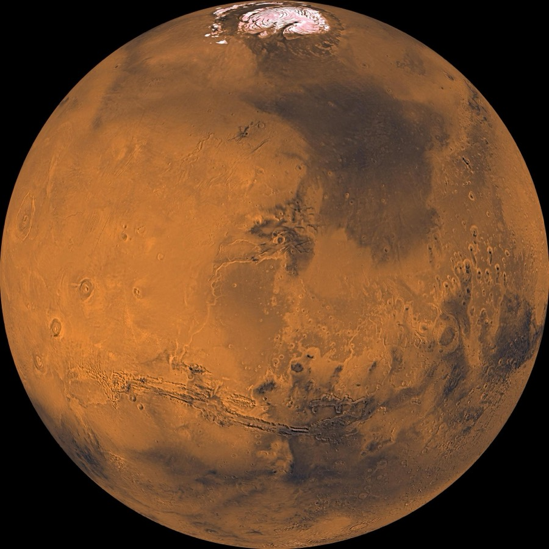
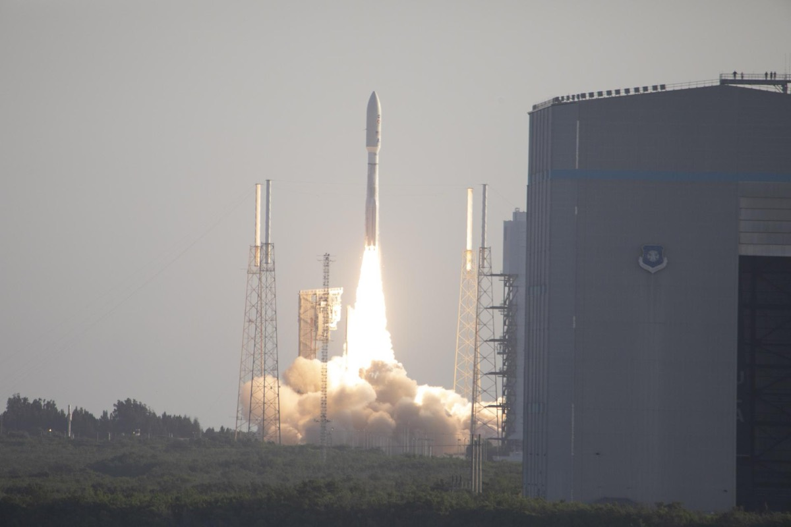
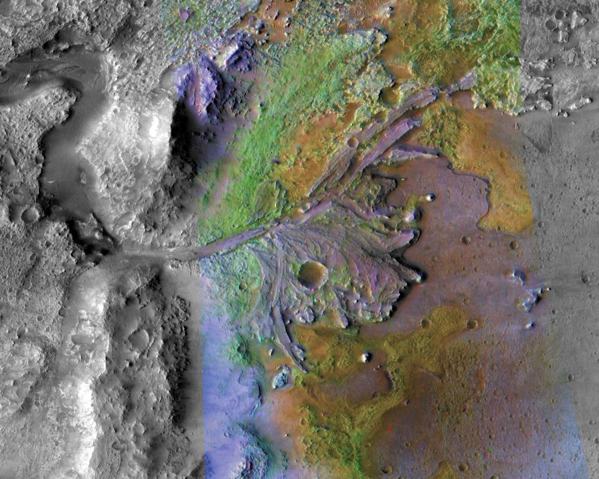
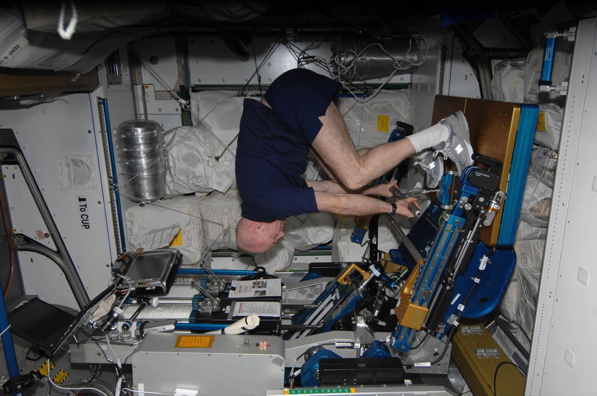
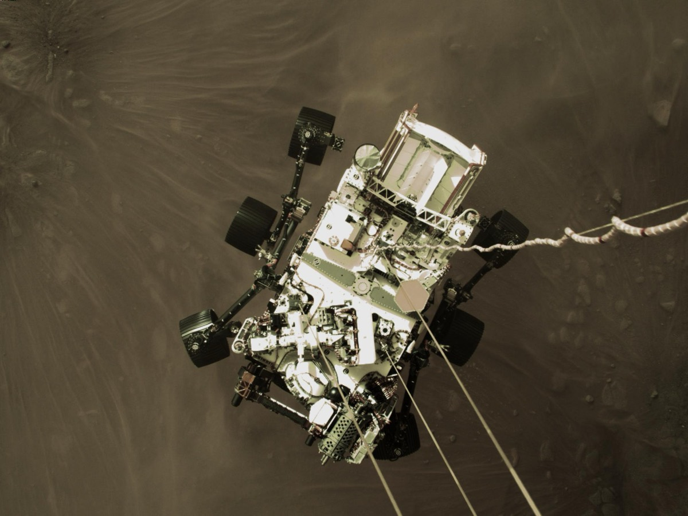
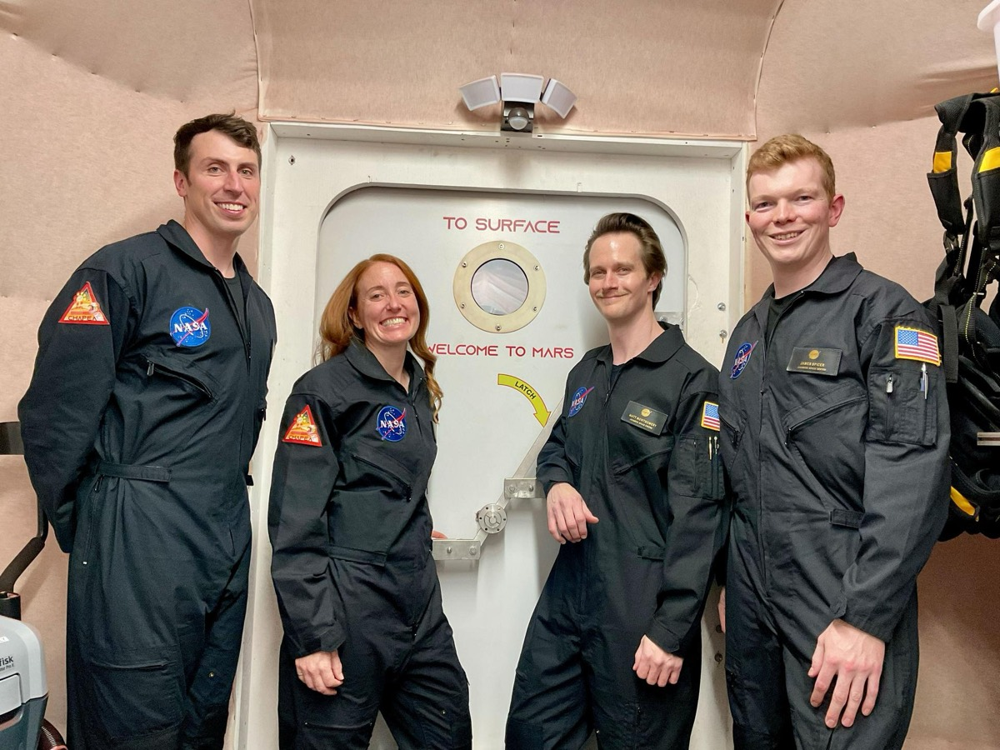
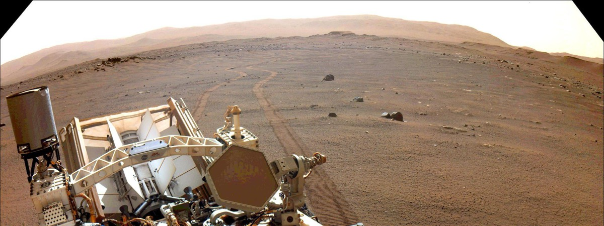
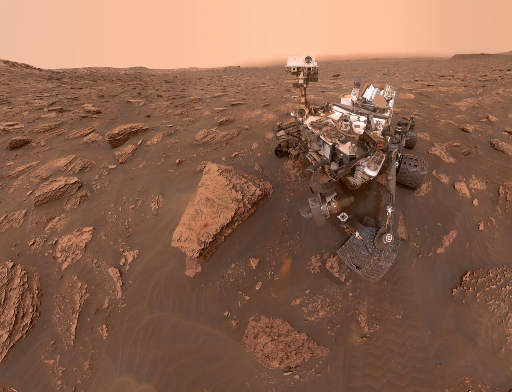
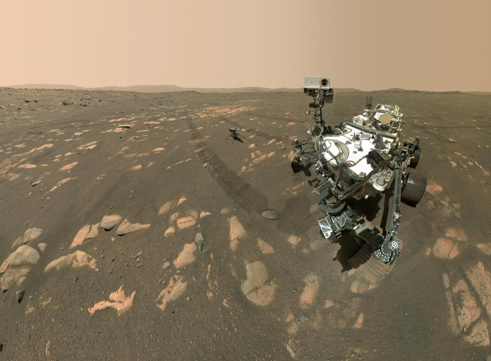

# Martian Map — Interplanetary Survival Guide

<p align="center">
  
  <br>
  <sub>Mars seen by the Viking orbiters. Credit: NASA/JPL/USGS (<a href="https://images.nasa.gov/details/PIA00407">PIA00407</a>)</sub>
</p>

A hackathon project by team **LAIKA II**.

Martian Map is an interactive guide to surviving on Mars. You go through a crewed mission **phase by
phase**: plan the trip from Earth, pick a landing site on a map built from NASA data, live through the
months in transit, land and explore the site, set up autonomous hubs, plan driving routes, and keep
your body healthy sol by sol.

Its core idea is to **cross public NASA data about Mars with what the human body needs**, so that any
point on the planet gets a clear verdict: viable, marginal or not viable, and why.

It works on desktop and tablet, in Spanish and English.

## What you can do

| Phase | Screen | What it does |
|---|---|---|
| Start | `home` | Game-style start screen with an animated ASCII background, START / CONTINUE and an index of every screen |
| 1 · Plan from Earth | `hohmann` | Computes a Hohmann transfer: launch windows, travel time, required Δv, arrival date and the Martian season at arrival. A "See equations and algorithm" dialog walks through every formula the app uses, step by step, with the numbers of the chosen window |
| 1 · Plan from Earth | `map` | Map of Mars with NASA Mars Trek basemaps and data layers, past landing sites and rover tracks, a Martian clock, a zone report for any point, the best zones for the current time, and choosing the landing site |
| 2 · Transit | `transit` | The trip day by day, a confinement routine, an original minigame with a score table, and the five hazards of human spaceflight |
| 3 · Descent | `descent` | First-person view of the terrain around the landing site, on foot or driving a rover with battery and damage, a mini map and live conditions |
| 4 · Surface | `hubs` | Place habitats, greenhouses, solar plants, ice mines and landing pads, each with its viability verdict and the full data breakdown |
| 4 · Surface | `routes` | Driving routes (up to 6 stops) that avoid large craters and steep slopes, with distance, time, elevation profile and turn-by-turn guidance |
| 5 · Survival | `guides` | A sol-by-sol journal (water, meals, sleep, exercise, accumulated radiation), the body's daily needs, and step-by-step guides for emergencies |
| 6 · Report | `dashboard` | Everything about the mission in one dashboard, printable or saved as PDF, and a button to start a new mission |
| Resources | `references` | Every source used in the app, with whether it was checked |

The phases are linked by data: the arrival date from the Hohmann planner sets the Martian season
(solar longitude, Ls) at landing, and that season changes temperature and dust on the map, in the hubs
and in the first-person view.

## The mission in real photos

Each phase of the app, matched with a real NASA photo of the same moment in an actual mission.

| | |
|---|---|
|  |  |
| **Phase 1 · Plan from Earth.** Perseverance lifts off on an Atlas V from Cape Canaveral on July 30, 2020, during its launch window to Mars. Credit: NASA/Frank Michaux ([KSC-20200730-PH-FMX01_0042](https://images.nasa.gov/details/KSC-20200730-PH-FMX01_0042)) | **Phase 1 · Landing site.** Jezero crater, the landing site chosen for Mars 2020, seen by the Mars Reconnaissance Orbiter. Credit: NASA/JPL-Caltech/MSSS/JHU-APL ([PIA23239](https://images.nasa.gov/details/PIA23239)) |
|  |  |
| **Phase 2 · Transit.** Astronaut André Kuipers exercises aboard the International Space Station, the daily routine that fights bone and muscle loss in weightlessness. Credit: NASA ([iss030e148403](https://images.nasa.gov/details/iss030e148403)) | **Phase 3 · Descent.** Perseverance moments before touchdown on February 18, 2021, photographed from the descent stage that lowered it. Credit: NASA/JPL-Caltech ([PIA24428](https://images.nasa.gov/details/PIA24428)) |
|  |  |
| **Phase 4 · Hubs.** The CHAPEA Mission 2 crew inside NASA's simulated Mars habitat, where crews live for a year as if on Mars. Credit: NASA ([jsc2026e403153](https://images.nasa.gov/details/jsc2026e403153)) | **Phase 4 · Routes.** Perseverance looks back at its wheel tracks on sol 381 (March 17, 2022). Credit: NASA/JPL-Caltech ([PIA25171](https://images.nasa.gov/details/PIA25171)) |
|  |  |
| **Phase 5 · Survival.** Curiosity's self-portrait on June 15, 2018, while a dust storm dimmed the sunlight in Gale crater. Credit: NASA/JPL-Caltech/MSSS ([PIA22486](https://images.nasa.gov/details/PIA22486)) | **Phase 6 · Report.** Perseverance and the Ingenuity helicopter on sol 46 (April 6, 2021). Credit: NASA/JPL-Caltech/MSSS ([PIA24542](https://images.nasa.gov/details/PIA24542)) |

All photos come from the [NASA Image and Video Library](https://images.nasa.gov/), resized for this
README. Sources are also listed in [docs/REFERENCES.md](docs/REFERENCES.md).

## Getting started

Requires Node 20.19 or later.

```bash
npm install
```

```bash
npm run dev
```

| Command | What it does |
|---|---|
| `npm run dev` | Development server at http://localhost:5173 |
| `npm test` | Runs every test in `tests/` with Node's built-in test runner, including the check that every text exists in both languages |
| `npm run build` | Production build in `dist/` |
| `npm run preview` | Serves the production build locally |

To run a single test file: `node --test tests/routes.test.js`.

### Supabase (optional)

Without any configuration the app saves everything in the browser. To also save missions and
minigame scores in the cloud, copy `.env.example` to `.env.local` and fill in the two values. Setup
steps are in [supabase/README.md](supabase/README.md).

### Deployment

Every push to `main` runs the tests and the build in GitHub Actions and publishes `dist/` to GitHub
Pages ([.github/workflows/deploy.yml](.github/workflows/deploy.yml)). Pages must be enabled once in
the repository settings (Settings → Pages → Source: GitHub Actions). For the deployed site to use
Supabase, set `VITE_SUPABASE_URL` and `VITE_SUPABASE_ANON_KEY` as repository variables.

## Project layout

```
src/core/       shared core: shell, state, languages, environment data, base map, Martian clock
src/modules/    one folder per screen
src/services/   optional Supabase saving and sync
src/styles/     global styles and design variables
supabase/       SQL migrations
tools/          Python scripts that turn NASA/USGS products into lightweight grids
public/data/    the processed grids the app loads
tests/          tests for the pure logic (run in Node, no browser)
```

## Data

The app only uses NASA and other trusted scientific sources, and every figure links to its source
inside the app. The environmental data is real: MOLA elevation, SWIM subsurface ice, the Robbins and
Hynek crater catalog, and the Mars Climate Database. Anything that comes from a model (climate,
pressure, radiation) is labeled as such in the interface, and where there is no data the app says
"no data" instead of showing a zero.

## Documentation

| Document | Contents |
|---|---|
| [docs/ARCHITECTURE.md](docs/ARCHITECTURE.md) | How the app is built and how to add to it |
| [docs/CONTRACTS.md](docs/CONTRACTS.md) | Shared interfaces: module definition, `ctx`, state, environment API |
| [docs/REFERENCES.md](docs/REFERENCES.md) | Every source used in the app and its verification status |
| [docs/BACKLOG.md](docs/BACKLOG.md) | Open items and ideas |
| [tools/README.md](tools/README.md) | Where each data file comes from and how to regenerate it |
| [supabase/README.md](supabase/README.md) | Supabase setup and what gets saved |
| [CLAUDE.md](CLAUDE.md) | Instructions for AI coding agents working in this repository |
